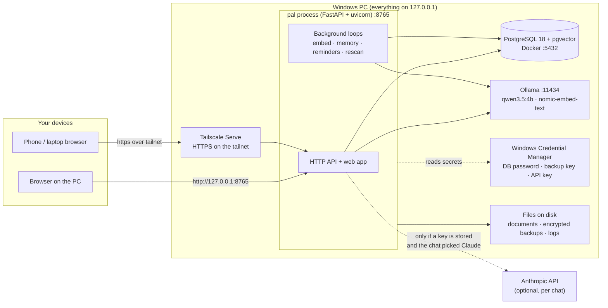
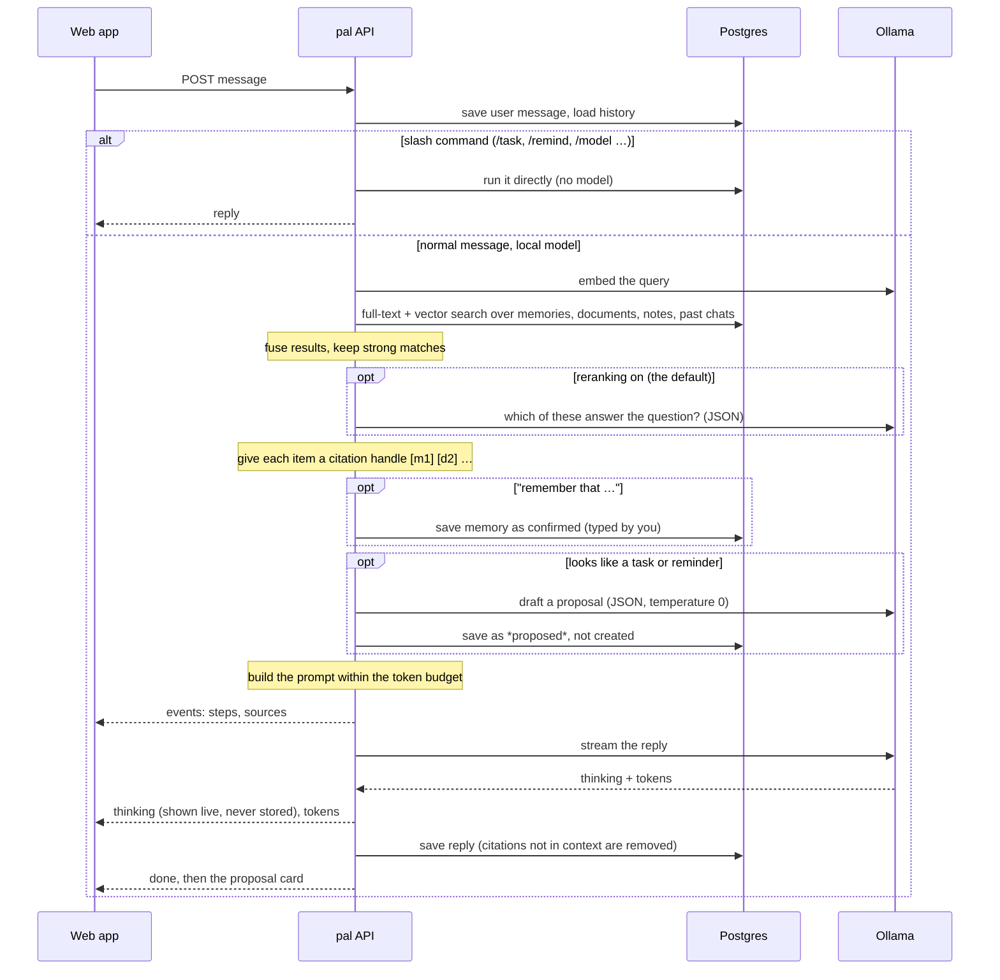

# pal architecture

This document explains how pal is built, how its parts talk to each other, and why it's built that way. For setup and everyday use, see the [README](README.md).

## The short version

pal is one Python process on one Windows PC. That process serves both the API and the web app, and it talks to two other local programs: PostgreSQL (in Docker) for storage and search, and Ollama for the AI models. Other devices reach it through Tailscale. Everything listens on `127.0.0.1` only, and pal blocks its own outbound network access at startup.

On Linux and Mac the same three parts run as Docker containers instead (see [Running in Docker](#running-in-docker)).

## Tech stack

| Layer | Choice | Notes |
|---|---|---|
| Server | Python 3.13, FastAPI, uvicorn | One process: API, background loops and static web app |
| Database access | psycopg 3 (sync) with `psycopg-pool` | Plain SQL, no ORM |
| Database | PostgreSQL 18 + pgvector, in Docker | Bound to `127.0.0.1` only (`compose.yaml`) |
| Search | Postgres full-text search (`tsvector` + GIN) and pgvector cosine similarity, fused with reciprocal-rank fusion | HNSW indexes; measured in [eval/RETRIEVAL.md](eval/RETRIEVAL.md) |
| Local models | Ollama: `qwen3.5:4b` for chat, `nomic-embed-text` (768-dim) for embeddings | Called with `httpx` on loopback |
| Cloud model (optional) | Anthropic Messages API over `httpx` server-sent events | No SDK; off unless a key is stored |
| PDF reading | Docling (layout, tables, OCR via RapidOCR), with pypdf as the fallback | Runs fully offline |
| Auth | Argon2 password hash (this PC), WebAuthn passkeys via `py_webauthn` (other devices) | Server-side sessions in Postgres |
| Secrets | Windows Credential Manager via `keyring`; a secrets folder in Docker and CI ([secret_store.py](src/pal/secret_store.py)) | Nothing secret in the repo or the database |
| Backups | `pg_dump`, encrypted with AES-256-GCM (`cryptography`) | 14 kept, outside the repo |
| Web app | React 19, TypeScript, Vite, `react-markdown`, KaTeX, highlight.js | Built to `web/dist`, served by pal; installable as a PWA |
| Remote access | Tailscale Serve | Provides HTTPS; pal still requires its own sign-in |
| Packaging | uv (Python), pnpm (web), Docker Compose (Linux and Mac) | CPU-only PyTorch on Linux keeps the image under 5 GB |
| Quality | pytest against a real Postgres test database with a fake LLM; ruff, mypy, ESLint; GitHub Actions | See [Testing](#testing) |

## How the parts talk to each other

### Web app → server

The React app is a single-page app served by pal itself, so it always talks to the same origin. Every request:

1. must arrive with an allowed `Host` (the loopback addresses, plus the tailnet name pal detects at startup) and, if it has one, an allowed `Origin`;
2. must carry the `x-pal-request` header, which a cross-site form can't add (CSRF protection);
3. must have a valid session cookie, except for sign-in routes.

Responses carry strict security headers, including a Content Security Policy that only allows pal's own scripts.

Ordinary API calls return JSON. Sending a chat message returns a stream of newline-delimited JSON events (`application/x-ndjson`), so the browser can show progress and tokens as they arrive.

### Sending a chat message

This is the busiest path in the system. All of it runs inside `POST /api/conversations/{id}/messages` ([src/pal/api.py](src/pal/api.py)).

When the chat uses Claude, the retrieval and project card steps are skipped by default, and Claude receives only the system prompt and this chat's own messages since it was switched to Claude. If you tick "Share matching memories and documents with Claude" for that chat, retrieval runs as usual (on the local models) and only the matching items go to Claude, listed under the reply.

### Background work

Four loops start with the server ([src/pal/app.py](src/pal/app.py)). Each runs its blocking work in a thread and logs failures instead of crashing the server.

| Loop | Every | What it does |
|---|---|---|
| Embed | 5 s | Gives new document chunks, memories and messages a vector. Backs off for a minute while Ollama is down. |
| Memory | 60 s | Finds conversations that have been quiet for 15 minutes and asks the model to suggest memories. They're stored as *proposed*. |
| Reminders | 30 s | Sends due reminders, makes the weekly digest on Monday mornings, and sends the morning brief once a day. |
| Folder rescan | 30 min (configurable) | Re-reads files in added folders that changed since pal stored them. |

Slow, optional jobs such as re-reading old PDFs with Docling never start by themselves. You start them from the Documents page, which shows progress and lets you stop them.

### Data model

The schema lives in numbered SQL files in [migrations/](migrations/). `pal serve` applies any new ones at startup. The main groups of tables are:

- **Chats:** conversations and messages. Each message has a generated full-text column, plus an embedding.
- **Memory:** memories, with origin (`stated` or `inferred`), status (`proposed` or `confirmed`), an optional project, a pinned flag and an embedding.
- **Documents:** documents (with the folder they came from and the parser that read them) and their chunks (heading, page, text, embedding). Uploaded PDFs are also kept as encrypted files outside the database ([kept_uploads.py](src/pal/kept_uploads.py)), so they can be re-read.
- **Work:** projects, tasks, notes (a decision is a note with `kind='decision'`), reminders, notifications and action proposals.
- **Access:** the owner, sessions, paired devices and their passkeys.
- **Other:** app settings (the values you can change in the UI) and weekly digest snapshots.

### Secrets

Three secrets exist: the database password, the backup encryption key (which also encrypts kept uploads), and the optional Anthropic API key. On Windows they're in Credential Manager under the service `pal`. In Docker and CI, `PAL_SECRETS_DIR` points to a folder with one file per secret, outside the repo. Only the command line can set them. The web app can't read or change them.

### Running in Docker

[compose.docker.yaml](compose.docker.yaml) runs three services on a private network: `db` (Postgres + pgvector), `ollama`, and `pal` (built from the [Dockerfile](Dockerfile)). Only pal's port is published, on the host's `127.0.0.1`. Inside its container pal has to listen on all interfaces so Docker can forward to it; it allows that only when `PAL_CONTAINER=1`. The network block lets pal look up the names `db` and `ollama` and connect only to the private addresses they resolve to. Secrets, backups and kept uploads live in `PAL_HOME` on the host (default `~/.local/share/pal-docker`), and backups run `pg_dump` directly instead of through `docker exec`.

## Design decisions and tradeoffs

| Decision | Why | Tradeoff |
|---|---|---|
| **Local-first, on one PC.** Everything runs on the owner's machine. | A personal assistant holds very private data. Keeping it on one machine removes provider breaches, training use and third-party access. | Only works while the PC is on. Model quality is limited to what fits on a consumer PC. Anyone with admin access to the PC can reach the data. |
| **The AI proposes, the owner decides.** Model-suggested memories, tasks and reminders are saved as proposals until confirmed. A memory you type yourself is saved straight away. | Small models make mistakes, and document text could try to steer the model (prompt injection). Neither can change your data unnoticed. | One extra click per proposal. |
| **Dates are parsed in code.** The model only copies the date phrase; [when.py](src/pal/when.py) works out the date and repeat rule. | In testing, the 4B model got date arithmetic wrong and mis-copied dates. Code is exact and testable. | Only phrases `when.py` knows are recognised, so unusual wording may need rephrasing. |
| **Hybrid search with a strict cutoff.** Full-text plus vector search, merged with reciprocal-rank fusion. Weak matches (cosine below 0.60) are dropped, at most 6 items go in the prompt, and the focus project ranks higher. | Keywords catch exact names and vectors catch paraphrases. Merging by rank avoids comparing different score scales. With a small model and 8K context, no context beats noisy context. | Loosely related information is left out on purpose. HNSW indexes can return too few rows when a filter applies (confirmed memories only, other chats), so every vector search turns on pgvector's iterative scan. |
| **The local model double-checks search results** (on by default, Settings > Model). It reads the top 12 candidates and keeps only those that answer the question ([rerank.py](src/pal/rerank.py)). | In the [evaluation](eval/RETRIEVAL.md), hybrid search alone still returned something for 30% of questions with no stored answer. Reranking brought that to 0% and put the right passage first every time. | About 0.3 s more per message. A malformed model reply falls back to the plain search order. |
| **A small default model, chosen by measurement.** `qwen3.5:4b` with an 8,192-token context. | It passed bars set before testing ([results](eval/RESULTS.md)): chat 4.3/5, memory 19/20, actions 19/20, median latency under 1 s. | Weak at multi-step arithmetic and long reasoning. Thinking levels and optional Claude chats cover that. |
| **Claude is opt-in per chat and sees only that chat.** Retrieval is skipped for Claude turns, and the network guard allows `api.anthropic.com` only when a key is stored. | A stronger model shouldn't quietly turn your private knowledge base into cloud traffic. | A per-chat switch can share matching items with Claude; it's off by default, and what was shared is listed under each reply. |
| **Network blocked inside the process.** At startup pal patches `socket` so any non-loopback connection or DNS lookup fails ([egress.py](src/pal/egress.py)). | Catches libraries that "phone home" without needing admin rights or firewall rules. | Covers only pal's process, not Ollama, Docker or other programs. A firewall would be stronger (the owner chose not to add one). |
| **Loopback only; remote access through Tailscale.** pal won't bind to anything but `127.0.0.1`, and remote devices still have to sign in to pal. | HTTPS and a private network with no open ports or certificates to manage. Tailscale identity headers are ignored. | Each device needs Tailscale installed. |
| **Password at the PC, passkeys elsewhere.** Other devices pair with a one-time code (10 minutes), then use a passkey. Device sessions last 30 days, or 14 days unused. | Passkeys can't be phished or reused, and a lost phone can be revoked instantly. | Pairing has to start from the PC or the command line. |
| **One process, sync database access, no ORM.** | One user, so simple, readable, testable code matters more than concurrency. Plain SQL keeps full-text and vector queries visible. | Doesn't scale to many users, which isn't a goal. |
| **Docling for PDFs, pypdf as fallback.** Each document records which reader produced it. | Layout-aware reading keeps headings and tables together, which gives much better search results. Runs locally, with Hugging Face forced offline. | A one-time 730 MB download and 1–5 s per page on the CPU, so re-reading is a job you start and can stop. Uploaded PDFs are kept encrypted so they can be re-read too, which uses disk space; uploads from before this change can't be. |
| **Reasoning shown, never stored.** Per-chat thinking levels: off, low, medium, high. | Reasoning is useful to watch but long and often wrong along the way. Feeding it back would crowd the context. | You can't reread it later. |
| **Secrets in the OS, backups encrypted.** No secrets in files or the database. Backups use AES-256-GCM with the key in Credential Manager. | The repo can be pushed safely, and a stolen backup file is useless on its own. | Lose the key in a Windows reinstall and the backups can't be opened, so `pal backup-key --show` exists. |
| **A Docker path for Linux and Mac**, alongside the native Windows setup. | Most reviewers and many users aren't on Windows. Containers give them the same three parts with one command. | Two setups to maintain. In Docker the AI runs on the CPU, and the secrets folder is protected by file permissions rather than an OS credential store. |
| **Deterministic reviews.** The weekly digest, morning brief and neglected-task scan are plain queries. | A list of what's overdue must be exact. A model could invent or drop items. | They list items rather than summarising in prose. |

## Testing

- `tests/` runs against a real Postgres test database (`pal_test`, or whatever `PAL_TEST_DB` says) with a fake LLM and a fake embedder tuned to behave like the real model's similarity scale. Each security rule (the S-numbers in module docstrings) has at least one test.
- `eval/run.py` compares models on chat, memory extraction and action proposals against fixed pass bars. It runs locally with no network.
- `eval/retrieval_eval.py` measures search quality with the real embedding model on a [made-up set](eval/retrieval/corpus.json) of 60 questions: recall@6, MRR, and how often pal correctly returns nothing. Results are in [eval/RETRIEVAL.md](eval/RETRIEVAL.md).
- GitHub Actions runs ruff, mypy, the test suite with an 80% coverage floor (against a real Postgres container), ESLint, and both web builds on every push.
- UI checks use Playwright with headless Chrome, including a virtual authenticator for the passkey flow.
- `pnpm build:demo` builds the web app with a fetch interceptor and made-up data, for the public demo. A normal build leaves it out.
