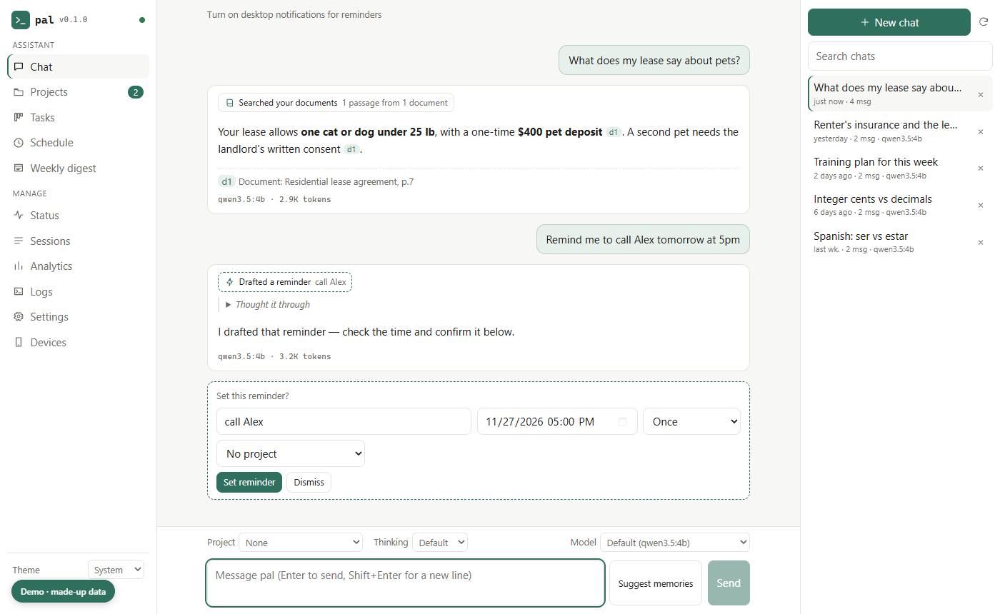
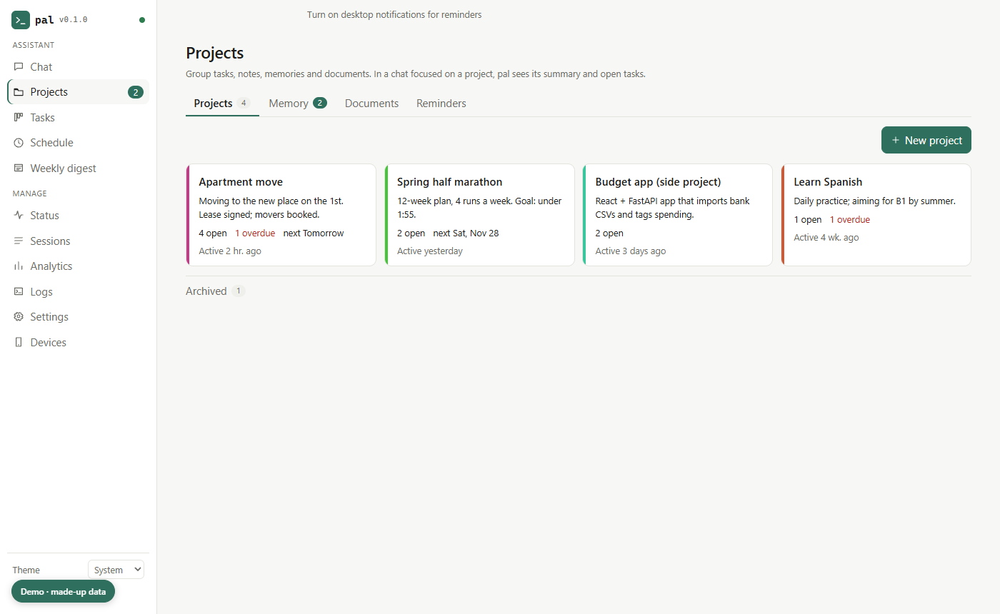

# pal

[](https://github.com/ericckzhou/pal/actions/workflows/ci.yml)

**A private AI assistant that runs on your own PC, answers from your notes and documents with citations, and can only *suggest* changes: it never makes them on its own.**

pal is a personal assistant that lives on your own Windows PC (or any Linux or Mac, using Docker). You chat with it, and it remembers things for you, reads your documents, keeps track of your projects and tasks, and reminds you about things.

Everything runs on your machine: the AI model, the database and the web app. Your conversations, memories and files are not sent anywhere. The one exception is a Claude model, which you can choose for a single chat if you want; see [Privacy and security](#privacy-and-security).

You use pal in a web browser, either on the PC itself or on your phone or laptop through Tailscale, a private network between your own devices.

**[Try the demo →](https://pal-assistant-demo.vercel.app)** It's the real web app filled with made-up data. Nothing you type is saved, and no AI is running behind it.



## What it does

**Chat.** Talk to a local AI model. When it answers, it can draw on what it remembers about you, your documents, your notes and earlier conversations, and it tells you where the information came from. When nothing you've stored fits the question, pal gives the model nothing, so it can't cite something unrelated. On a held-out test set it finds the right item for 97% of questions, and sends nothing for every off-topic question ([full results](eval/RETRIEVAL.md)). Under each answer, **Why these sources?** shows how pal picked them: what each search found, what the double-check kept or dropped, and what was cut to fit. If a reply fails, your message goes back into the text box so you can send it again. You can set how much each chat "thinks" before it answers (off, low, medium or high).

**Memory.** Say "remember that…" and pal saves the fact. After a conversation goes quiet, pal may also suggest a few things to remember. Nothing is saved until you say yes. When something changes (a new job, a move), pal can suggest that the new memory replaces the old one. The old one is kept under Replaced, where you can restore it. pal also tells the model when each memory was saved, so newer facts win.

**Documents.** Upload PDFs, Markdown or text files, or point pal at a folder. It reads them, including tables and scanned pages in PDFs, so you can ask questions about them later. Folders are rescanned every 30 minutes, so edited and new files are picked up on their own.

**Projects and tasks.** Keep projects, tasks, notes and decisions in one place. Each project has its own page with its open tasks, related memories and documents, and upcoming reminders.

**Reminders.** Set one-off or repeating reminders. A reminder set for 9 a.m. stays at 9 a.m. when the clocks change.

**Morning brief and weekly digest.** Each morning pal sends one notification listing what's due that day (nothing on empty days). Every Monday it writes a digest: what you finished last week and what's due this week. It's built by plain database queries, not the AI, so it never makes anything up. The Status page has an **Attention** list of tasks and projects that have gone quiet, each with a "Still on it" button. The brief's hour and the folder rescan interval are set under Schedule > Automations (0 turns either off).

**You stay in charge.** The AI can *suggest* a task or a reminder, but it is only created once you confirm it. You can also create them yourself with `/task`, `/remind`, `/note`, `/decision` and `/project`.

**Dashboard.** See status, sessions, your schedule, usage, logs and settings.

**Your devices.** Pair a phone or laptop with a one-time code, then sign in with a passkey instead of typing a password.



## Privacy and security

pal treats the PC it runs on as trusted, and everything else as untrusted.

- **Only reachable from your PC.** pal only accepts connections from the PC itself. Your other devices reach it through Tailscale, which adds encryption (HTTPS). Every device still has to sign in to pal.
- **No internet access.** When pal starts, it blocks itself from connecting to the internet. There are two exceptions, and both are off unless you turn them on:
  - **Claude chats.** If you save an Anthropic API key, you can pick a Claude model for a chat. Only that chat's messages are sent to Anthropic. Your memories, documents and notes are not sent, unless you tick "Share matching memories and documents with Claude" in that chat. Then only the items that match each message are sent, and they're listed under the reply.
  - **PDF reader setup.** `pal pdf-models` downloads the PDF reader's models once. After that, reading PDFs works offline.
  - The block covers pal itself, not other programs on your PC such as Ollama or Docker.
- **No passwords in files.** The database password and API keys are kept in Windows Credential Manager (with Docker, in a private folder outside the project). Your pal password is stored only as a secure hash.
- **Protected against common web attacks.** pal checks where every request comes from and refuses anything unexpected.
- **The AI can't act on its own.** Anything the AI produces (memories, tasks, reminders) waits for your approval. Text inside your documents is treated as content to read, never as instructions to follow.
- **Encrypted nightly backups.** pal backs up its database every night, encrypts the backup and keeps the 14 most recent in `%LOCALAPPDATA%\pal\backups`.
- **Encrypted copies of uploaded PDFs.** So a better PDF reader can re-read them later, pal keeps uploaded PDFs encrypted with the same key in `%LOCALAPPDATA%\pal\uploads`. Deleting a document deletes its copy.

> **Important:** run `uv run pal backup-key --show` once and keep the key somewhere safe and offline. If you reinstall Windows without it, your backups and kept uploads can't be opened.

## What you need

This section is for Windows. On Linux or a Mac, skip to [Running with Docker](#running-with-docker-linux-and-mac).

- Windows 10 or 11
- [Python 3.13](https://www.python.org/) and [uv](https://docs.astral.sh/uv/)
- [Docker Desktop](https://www.docker.com/products/docker-desktop/), for the database
- [Ollama](https://ollama.com/), to run the AI models
- [Node.js](https://nodejs.org/) and [pnpm](https://pnpm.io/), to build the web app
- [Tailscale](https://tailscale.com/), only if you want to use pal from other devices

## Getting started

Run these from the project folder.

**1. Download the AI models**

```sh
ollama pull qwen3.5:4b          # the chat model
ollama pull nomic-embed-text    # used to search your documents and memories
```

**2. Start the database.** The first time, this creates a database password and saves it in Credential Manager.

```sh
uv run scripts/db.py up
```

**3. Install pal and set up the database**

```sh
uv sync
uv run pal migrate
```

**4. Build the web app**

```sh
cd web
pnpm install
pnpm build
cd ..
```

**5. Optional: better PDF reading.** This downloads the PDF reader's models once. Without them, pal uses a simpler reader.

```sh
uv run pal pdf-models
```

**6. Choose your password and start pal**

```sh
uv run pal set-password
uv run pal serve
```

Then open **http://127.0.0.1:8765** in your browser.

### Using pal from your phone or laptop

With Tailscale installed and signed in on the PC, run:

```sh
tailscale serve --bg http://127.0.0.1:8765
```

Then pair your device from the **Devices** page. If you can't get into the web app, you can make a pairing code from the command line instead:

```sh
uv run pal pair --name Phone
```

### Starting pal automatically

To have pal start every time you sign in to Windows:

```powershell
powershell -File scripts/install-autostart.ps1
```

This starts Docker and Ollama, waits for the database, then starts pal. Logs are written to `%LOCALAPPDATA%\pal\logs\pal.log`.

To turn this off again:

```powershell
Unregister-ScheduledTask -TaskName pal -Confirm:$false
```

### Using Claude (optional)

```sh
uv run pal claude-key --set
```

Restart pal, and the Claude models show up in the model picker above the chat box. Chats that use a local model stay fully offline. To remove the key, run `uv run pal claude-key --clear`.

### Connecting Google (optional, in progress)

pal can read your Google Calendar and Drive, and search Gmail when you ask. All of it is read-only. Calendar and Drive are copied into pal's own database on this PC; Gmail is never copied, only searched. Nothing goes to any server run by pal; there isn't one. *Calendar works now: events show on the Schedule page, in the morning brief, and in answers to questions like "what's on Thursday?" (pal says what it sees on your connected calendars, never that you're free). Drive works too: pick folders with `pal drive-folders add <folder link>`; Docs, Sheets, Slides, PDFs and text files in them (and in folders inside them) become searchable documents. Gmail comes next.*

You sign in with your own Google OAuth client, because a public repo can't ship one. It takes about 10 minutes, once:

1. Go to [console.cloud.google.com](https://console.cloud.google.com), create a project (any name), and in **APIs & Services › Library** enable the **Google Calendar API**, **Google Drive API** and **Gmail API** (only the ones you'll use).
2. In **APIs & Services › OAuth consent screen**: choose **External**, fill in an app name and your email, and add yourself under **Test users**.
3. Still on the consent screen, click **Publish app** so it shows **In production**. In "Testing", Google ends the sign-in every 7 days. Publishing does *not* get the app verified: Google shows an "unverified app" warning when you sign in. That's expected for a personal app; click **Advanced › Go to (your app)**. Google allows unverified apps for personal use, including Gmail's restricted permission.
4. In **APIs & Services › Credentials**: **Create credentials › OAuth client ID**, type **Desktop app**. Download the JSON.
5. Store it and connect one service at a time:

```sh
uv run pal google-client --set path/to/client.json   # then delete the downloaded file
uv run pal connect google calendar                   # or drive, or gmail
uv run pal connections                               # what's connected and when it last synced
uv run pal disconnect google calendar                # or "all"
```

pal asks Google only for the service you're connecting. Google's Drive permission covers your whole Drive, even though pal syncs only the folders you pick. If you untick the permission on Google's screen, nothing is connected. Disconnecting deletes everything pal synced from that service. When the last Google service is disconnected, pal also tells Google to end its access. Google can't take back a single permission on its own, so until then the grant stays listed at [myaccount.google.com/permissions](https://myaccount.google.com/permissions). Signing in on the Docker setup isn't supported yet.

### Running with Docker (Linux and Mac)

You need Docker. Everything else (the database, Ollama and pal) runs in containers.

```sh
bash scripts/pal-docker.sh setup
```

This creates a database password, builds pal, starts everything, downloads the AI models and asks you to choose your password. Then open **http://127.0.0.1:8765**.

| | |
|---|---|
| `bash scripts/pal-docker.sh up` / `down` | Start or stop pal (your data is kept) |
| `bash scripts/pal-docker.sh logs` | Follow pal's log |
| `bash scripts/pal-docker.sh pal <command>` | Run any command from the table below, e.g. `pal backup-key --show` |

Your secrets, backups and kept uploads are in `~/.local/share/pal-docker` (set `PAL_HOME` to change it). To use a port other than 8765, set `PAL_PORT`. To add documents from a folder, start pal with `PAL_DOCS=/path/to/folder` and run `bash scripts/pal-docker.sh pal ingest /docs`. Only pal's port is published, and only on `127.0.0.1`; the database and Ollama aren't reachable from outside Docker. The AI runs on the CPU in this setup.

## Commands

Run each one as `uv run pal <command>`.

| Command | What it does |
|---|---|
| `serve` | Start pal (it updates the database first if needed) |
| `set-password` | Change your password. This signs out every device. |
| `ingest <path>` | Add a file or folder of documents. Run it again to pick up changes. |
| `pdf-models` | Download the PDF reader's models (once) |
| `pair --name <name>` | Make a one-time code to pair a new device |
| `devices` | List your paired devices |
| `revoke-device <name>` | Remove a device and sign it out |
| `revoke-sessions` | Sign out every device right now |
| `backup` | Make a backup now. Add `--check` to also test that it restores correctly. |
| `backup-key --show` | Show the backup key so you can store it safely. Use `--set` to restore it on a new install. |
| `decrypt-backup <file> <out>` | Turn an encrypted backup back into a normal database dump |
| `claude-key --set` / `--clear` | Save or remove your Anthropic API key |
| `google-client --set <file>` | Save your Google OAuth client (see Connecting Google) |
| `connect google <service>` | Sign in and connect `calendar`, `drive` or `gmail` |
| `disconnect google <service>` | Remove a service and everything synced from it (`all` for every one) |
| `connections` | List connected services and their last sync |
| `drive-folders list` / `add <link>` / `remove <name>` | Choose which Google Drive folders pal syncs |
| `migrate` | Update the database structure (`serve` already does this) |

## Settings

You can change most things on the **Settings** page, such as which models are available, the default thinking level, and whether the model double-checks search results before answering (on by default; it adds about a third of a second per message). Lower-level defaults like the port and backup retention are in [src/pal/config.py](src/pal/config.py).

## Tech stack

| | |
|---|---|
| **Server** | Python 3.13, FastAPI, uvicorn, psycopg 3 (plain SQL, no ORM) |
| **Database** | PostgreSQL 18 with pgvector, in Docker |
| **Search** | Postgres full-text search plus vector search, merged with reciprocal-rank fusion |
| **AI models** | Ollama: `qwen3.5:4b` for chat, `nomic-embed-text` for search. Claude via the Anthropic API (optional). |
| **Documents** | Docling for PDFs (layout, tables, OCR), with pypdf as a fallback |
| **Sign-in** | Argon2 password at the PC, passkeys (WebAuthn) on other devices |
| **Web app** | React 19, TypeScript, Vite |
| **Remote access** | Tailscale Serve |
| **Secrets** | Windows Credential Manager; a private secrets folder with Docker |
| **Quality** | pytest (88% coverage), ruff, mypy, ESLint, GitHub Actions; a [search-quality evaluation](eval/RETRIEVAL.md) |
| **Packaging** | uv, pnpm; Docker Compose for Linux and Mac |

How the parts talk to each other, and why it's built this way, is explained in **[ARCHITECTURE.md](ARCHITECTURE.md)**.

## For developers

<details>
<summary>Project layout and running tests</summary>

**Project layout**

```
src/pal/        Server, CLI, and features (chat, memory, retrieval, work, reminders, devices, ...)
web/            The web app, built to web/dist and served by pal
migrations/     Database migrations, applied in order
scripts/        Database container helper, autostart, Docker and demo scripts
eval/           Model comparison (RESULTS.md) and search-quality evaluation (RETRIEVAL.md)
tests/          pytest suite (real Postgres test database, fake LLM)
compose.yaml    Windows: the Postgres container, published on 127.0.0.1 only
compose.docker.yaml, Dockerfile   Linux and Mac: pal, Postgres and Ollama in containers
```

**Tests and tools**

```sh
uv run pytest                  # needs the database running; uses "pal_test" (override with PAL_TEST_DB)
uv run pytest --cov=pal        # with coverage
uv run ruff check src tests eval scripts && uv run mypy   # lint and type check (CI runs both)
cd web && pnpm lint            # lint the web app
cd web && pnpm watch           # rebuild the web app when files change
cd web && pnpm build:demo      # a demo build of the web app with made-up data, in web/dist-demo
bash scripts/deploy_demo.sh    # build the demo and publish it to pal-assistant-demo.vercel.app (needs the Vercel CLI)
uv run eval/run.py --local     # compare local models, offline
uv run python eval/retrieval_eval.py --write   # measure search quality with the real models; updates eval/RETRIEVAL.md
```

</details>

## Contributing

Bug reports and pull requests are welcome; see [CONTRIBUTING.md](CONTRIBUTING.md) and the [Code of Conduct](CODE_OF_CONDUCT.md). Please report security problems privately, as described in [SECURITY.md](SECURITY.md).

## License

[MIT](LICENSE)
